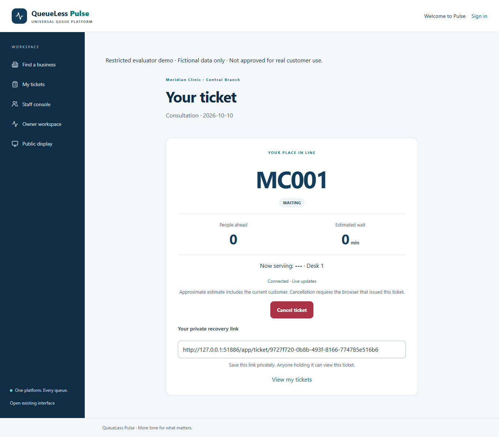
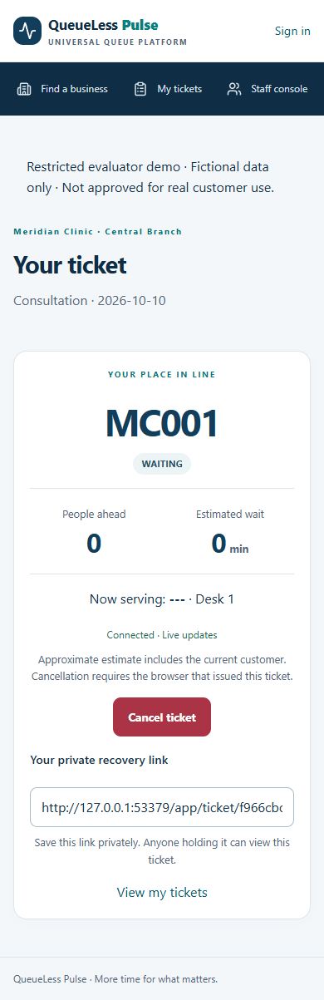
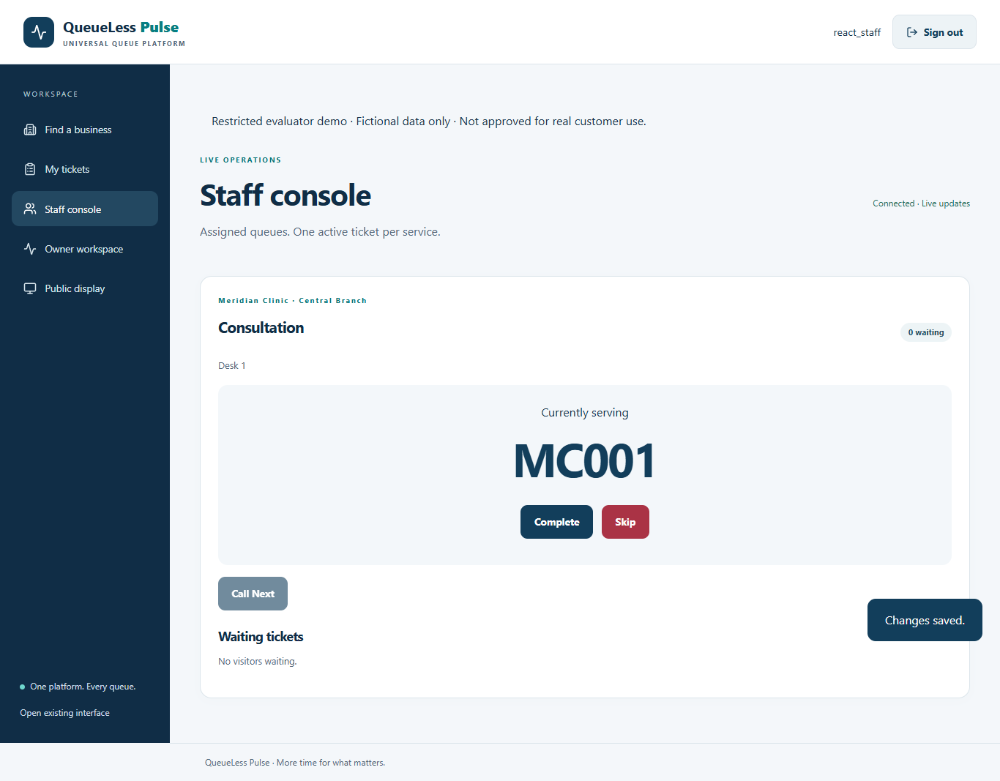
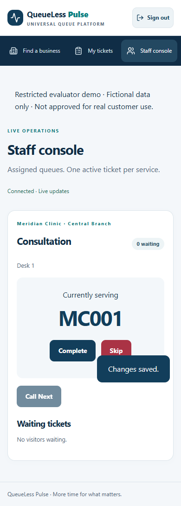
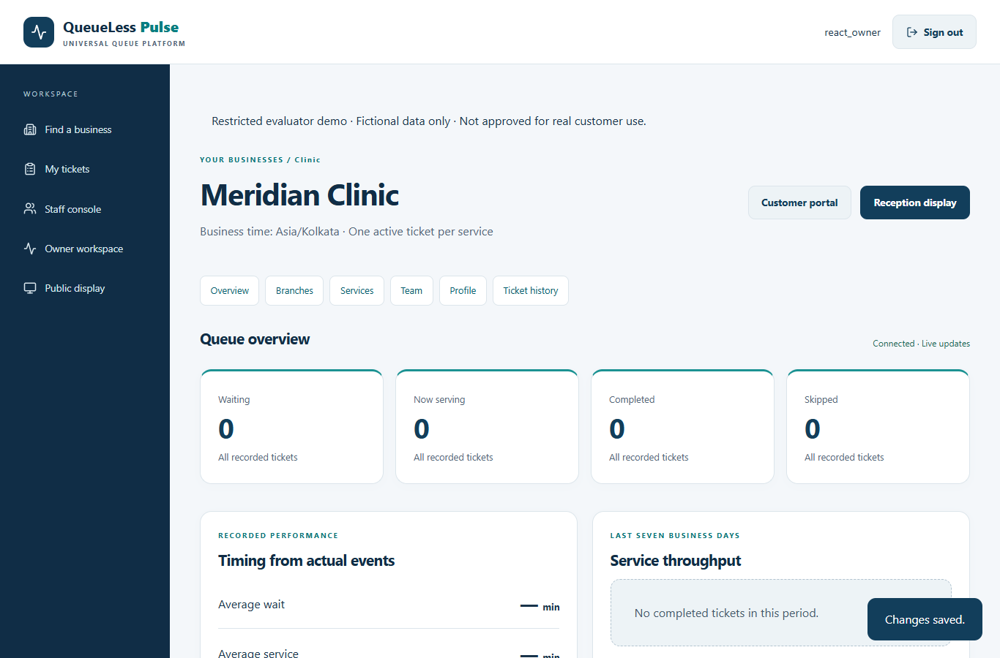
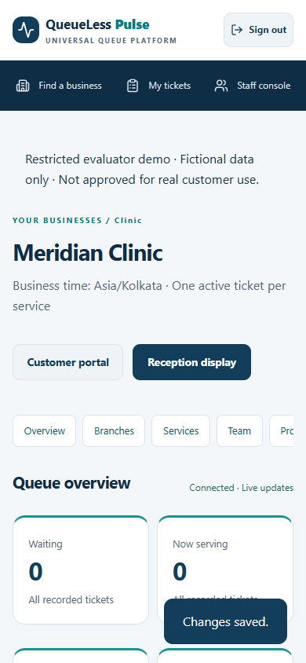
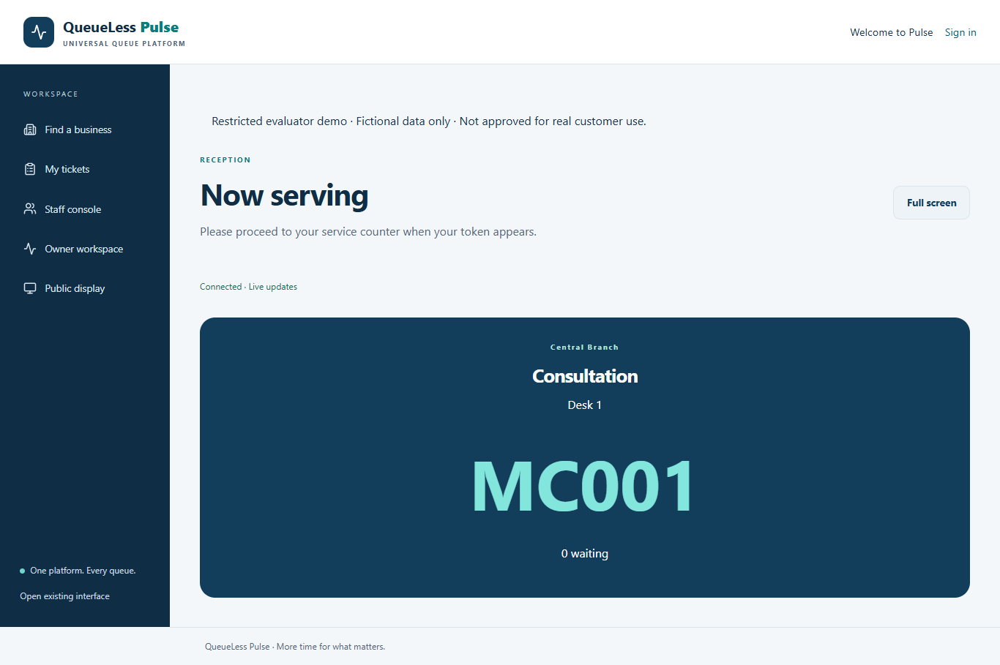
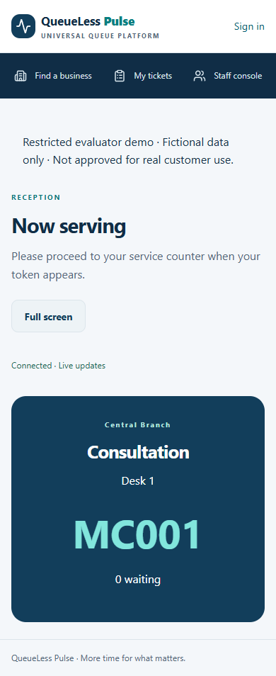

# React release-candidate verification

Scope: additive React + strict TypeScript migration and restricted evaluator demo. Branch: `feat/react-typescript-frontend`. PR #1 merged at `d8c22d4187c5f14ba804fe416c9c891b49b6faba`; synchronized baseline: **74 passed, 0 failed, 0 skipped in 165.29 seconds**. Baseline post-merge Actions run 38031534827 succeeded.

## Local gate (2026-10-10)

Full Python suite: **97 passed, 0 failed, 0 skipped in 213.98 seconds** (`evidence/release-final.xml/.log`). The final full rerun behind the outer evaluator gate passes **97 passed, 0 failed, 0 skipped in 220.37 seconds** (`evidence/release-demo-final.xml/.log`). This final gated run supersedes the earlier local run.

| Test group | Passed |
| --- | ---: |
| Preserved baseline backend/config/CLI/tenant/PostgreSQL/legacy browser cases | 74 |
| API response contracts, auth/CSRF, scope, lifecycle and concurrent replay | 14 |
| New PostgreSQL desktop/mobile React workflows | 2 |
| Rate limits, header spoof resistance, PostgreSQL atomic counters and additive migration | 4 |
| Restricted demo gate and required secret configuration | 3 |
| Python total | 97 |

Frontend: **14 passed, 0 failed, 0 skipped across 4 Vitest/RTL files**. Strict TypeScript, ESLint, contract generation drift check and production Vite build pass. Python compilation and `pip check` pass. Python pip-audit reports no known vulnerabilities; pnpm audit reports zero informational/low/moderate/high/critical vulnerabilities across 331 dependencies. Gitleaks 8.30.1, downloaded from the official release and checked against pinned SHA-256, finds no leaks in the exact tracked index or complete two-commit baseline history; no secret rules are disabled. The final release index is rescanned before commit; CI repeats both scans with full checkout history. Preview files are rejected by the tracked-path guard.

The production build is split by business domain: initial JavaScript about 340 KB / 107.5 KB gzip, with lazy page chunks. No bundle-size/coverage/compliance guarantee is claimed.

## Demonstrated parity

| Experience | Verified behavior |
| --- | --- |
| Customer | Directory/business/branch/service entry; decoded real React QR; anonymous replay-safe issue; reload/recovery; live WAITING/CALLED/COMPLETED/SKIPPED/CANCELLED, ETA/position; owner-session cancellation; non-owner recovery cannot cancel; mobile layout |
| Staff | Existing hashed login/session, scoped queue/waiting list, call/complete/skip, empty state and revocation refresh; preserved one-active/FIFO/race/conflict baseline controls |
| Owner | Register/login, business/profile/branches/services, activation/editing, secure unassigned staff, assignment/revoke, one-use invitation acceptance/expiry, actual counts/timing/throughput, filtered paginated history, scoped QR downloads |
| Display | Branch-specific public numbers/service/counter, updates, fullscreen entry/exit, simulated connection loss/recovery, no private recovery/customer IDs |
| Shared | 1366px desktop and 390px mobile Chromium/Edge workflows, Radix keyboard dismissal/focus semantics, axe WCAG 2 A/AA + 2.1/2.2 AA rules without violations on exercised views/dialog, no global horizontal overflow, no page errors, manifest/worker and exactly three public cached static assets |

Browser workflows use real PostgreSQL random schemas in the isolated `_test` database. Existing SQLite browser tests retain PR #1's separate pooled connections and server cleanup. Production Secure/HttpOnly/SameSite cookies are covered by the existing production factory regression. New limiter integration proves eight simultaneous requests admit exactly two when configured for two; service locks and the original 13 PostgreSQL baseline scenarios remain intact. API serializers are validated against the same JSON Schema that generates TypeScript responses.

## Failures found and corrected

The initial new desktop/mobile run found mobile grid overflow; `minmax(0,1fr)` and sidebar min-width preserve deliberate navigation/table scrolling. A diagnostic edit briefly corrupted a test label under Windows cp1252 and was corrected to UTF-8. An expanded fullscreen assertion failed because another browser tab was active; bringing the display to the foreground verifies the real API without removing the assertion. The limiter's first 429 path incorrectly passed an exception instance to Flask abort; it now raises the HTTP exception and preserves Retry-After. The first outer-gate test used an uninitialized new in-memory test factory; its metadata is now initialized. These failures remain in ignored local evidence; none was hidden/skipped or bypassed in the final gate.

## CI and production build

The separate migration PR's push and pull_request checks are authoritative for the current head. The workflow keeps PostgreSQL 18 and isolated CI-only credentials, installs pinned Python/Node/pnpm dependencies, scans Git/index secrets, checks contracts/type/lint/components, executes the actual Render build script, audits both ecosystems, runs the entire Python suite with at least 97 cases and zero failures/errors/skips, then starts two-worker/four-thread Gunicorn against a disposable test schema. Gunicorn smoke verifies health, restricted navigation, deep links/assets and production cookie flags. Artifacts include JUnit, screenshots, audits and smoke evidence. No production credentials or database are used.

Windows cannot run Gunicorn natively. Hosted HTTPS, physical install prompts, real Render proxy-chain behavior, cloud persistence/backup and live four-role workflows are deployment-stage checks, not established by local tests. CI results and URLs are recorded in the PR after actual completion.

## Release constraints

No known failing requested workflow remains after the final gate; no real-customer production readiness or legal approval is claimed. The permitted release is privately authorized synthetic-data evaluation. Operator/privacy contact/reviewed policy are unresolved; unrestricted registration, real-data collection and general commercial use are launch-blocked. Draft legal/storage documents describe actual persistence and missing decisions. Account reset/export/deletion, approved retention, operational backups/monitoring/incident response and wider-load testing remain unresolved for commercial use; physical device installation remains unverified.

Existing UI and QR links stay available for rollback, under the same demo gate when enabled. There is no destructive migration, queue rewrite or preview seed import. `QueueLess_MVP`, Antigravity's `seed.py`/preview databases/.env/fixed secrets, environments, raw logs/test artifacts and generated dist are excluded. Curated screenshots below contain only isolated fictional fixture data; recovery URLs refer to destroyed local test schemas.

## Review screenshots

| Experience | Desktop | Mobile |
| --- | --- | --- |
| Customer |  |  |
| Staff |  |  |
| Owner |  |  |
| Display |  |  |

## Reproduce

Build frontend first (`pnpm --dir frontend install --frozen-lockfile --strict-peer-dependencies`, then typecheck/lint/test/build); check contracts with `python scripts/generate_contracts.py --check`. Supply only an isolated PostgreSQL TEST_DATABASE_URL ending `_test`, install Chromium (`python -m playwright install chromium`) or set the installed Edge override, then `python -m pytest -q --junitxml=evidence/release-demo-final.xml`. `python scripts/verify_secrets.py` scans the tracked index/history; stage only intended source/docs before running it. Advisory scans: `python -m pip_audit --format json --output evidence/react-python-audit.json` and `pnpm --dir frontend audit --audit-level=low`. Linux: `bash scripts/render-build.sh` and `python scripts/verify_gunicorn.py`. Exact local UI preview commands are in README.md; deployment sequence/blockers are in RELEASE_RUNBOOK.md.
